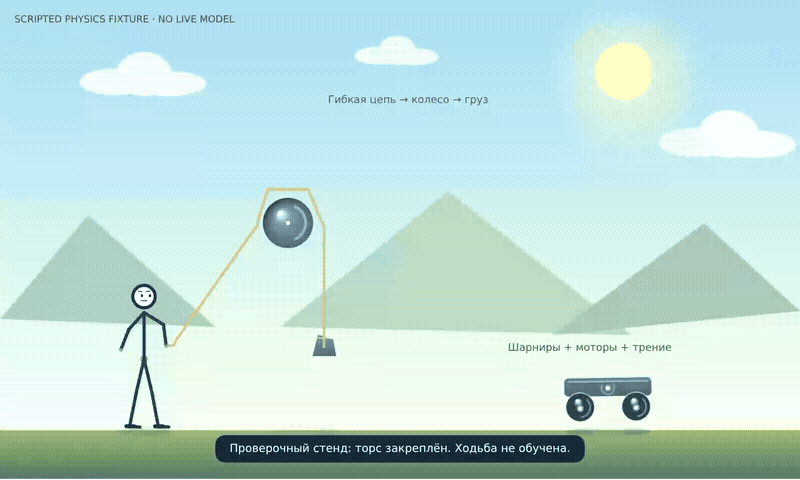
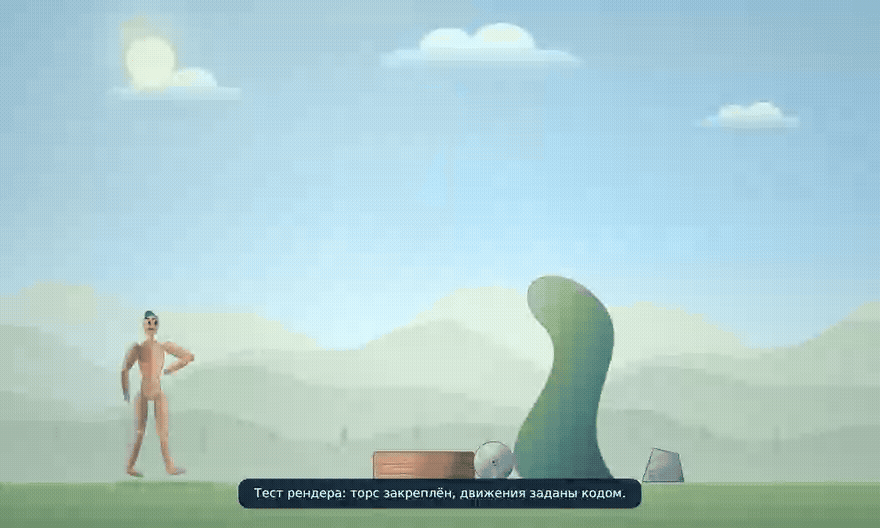
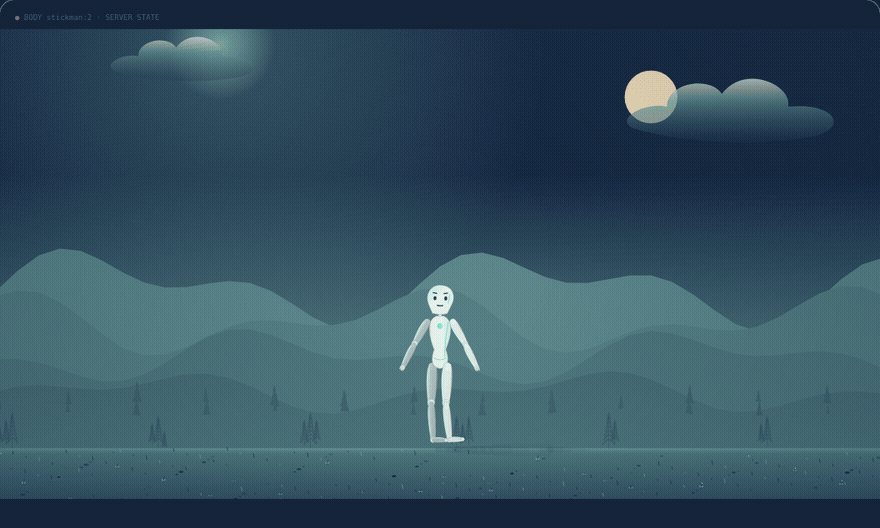

# Dagi — a debugging instrument for an AI agent

**This repository is not a game.** The physical workshop is a *debugger for an
agent*: a sandbox where every claim the agent makes becomes a measurement, every
change is versioned and replayable, and every failure is isolated instead of
described. Around it sits a compact agent core (streaming provider adapter,
tool registry, durable SQLite state, delegation, budgets) whose purpose here is
to be *tested*, not merely run.



*(12 s loop from a 2112×1267 recording. Scripted fixture — no live model. It
shows the instrument, not intelligence: a rope over a wheel to a weight, a cart
with motors, and a body that must earn its stance.)*



*(7.6 s loop. Scripted render fixture — «Тест рендера: торс закреплён, движения
заданы кодом.» Muscle/skin/bone surfaces, gradient wood-metal-stone materials,
sun, clouds, parallax mountains; the camera closes on the body mid-motion. It
shows the rendering surface of the instrument, not learned standing.)*

## Why a physical world is the right instrument

An LLM agent is normally debugged through prose: it says what it did, and you
hope. This sandbox replaces hope with instrumentation:

- **Claims become measurements.** "I walked to the target" is not accepted; the
  run records tick-by-tick pose, contacts, displacement, foot slip, bone-length
  error and motor work, and the goal check passes or fails on those numbers.
- **Every change is an experiment with a baseline.** A candidate is tested
  against the current world in a clone; if the trial degrades or fails, the
  publication is blocked and the working version survives. There is no "trust
  me" path from an edit to the live world.
- **State is inspectable, memory is visible.** The agent's programs, policy
  memory, reflections and self-passport are persisted and re-readable; a reload
  or restart changes nothing silently, and nothing auto-replays or auto-spends.
- **Failures are isolated, not narrated.** A broken controller is disabled by
  name with its source preserved; the world keeps settling; the next model turn
  sees the actual error. A failing check blocks release instead of shipping a
  known-broken build.
- **The debug loop is the agent's own.** Observe → hypothesize → trial →
  publish/keep → reflect. The human uses the same loop from the outside: the
  same trials, the same metrics, the same replayable frames.

## The debugging surface

**The body is the probe.** One stickman per session; canvas renders the real
simulation (joints, contacts, objects), and the agent receives structured
geometry — not screenshots — unless the operator enables the world-frame
observation for a vision model.

**The world is the fixture rack.** Objects, mechanisms (ropes over wheels to
weights, carts with motors, joints, springs, gears), materials with density and
friction, editable scenery and appearance: the conditions under test are
authored, versioned and reproducible. A clean session is an empty world with a
bare skeleton — no preset scenario decides what is being tested.

**Abilities are the code under test.** Feedback policies, saved programs and
extra limbs are authored as code, executed locally at 60 Hz without per-frame
model calls, measured in trials, and published only on passing checks. A skill
button is a control surface, never a claim of mastery.

**Tools are exercised on the live object.** `game_observe` reads state, schemas
and source; `game_iteration` submits one coherent change package, runs real
trials and publishes through a countdown; `game_life` runs or pauses the world
locally without model calls. Human controls and the agent's own buttons are
local events, no LLM round-trip.

### Video evidence

Scripted fixtures that prove the instrument executes; each link opens the raw
recording:

- [`hello-dagi-storyboard.gif`](docs/examples/hello-dagi-storyboard.gif) — v9 cinema storyboard: the first authored short beat by beat (source frames from the operator's verification capture; the raw MP4 was not shipped in the archive).
- [`vector-character-fixture.webm`](docs/examples/vector-character-fixture.webm) — v7 vector character (source of the second loop above): muscle-surface anatomy, vector materials and layered scenery under shared light, physical arm movement, body/face camera framing. The torso is explicitly supported; a rendering fixture, not learned standing.
- [`physical-workshop-fixture.mp4`](docs/examples/physical-workshop-fixture.mp4) — rope → wheel → weight, cart with motors, editable scenery, the «торс закреплён. Ходьба не обучена.» bench banner.
- [`workshop-physical-test-bench.webm`](docs/examples/workshop-physical-test-bench.webm) — the physical test bench: unassisted start, joint force controls, mechanism measurements (the source of the loop above).
- [`workshop-unassisted-start.webm`](docs/examples/workshop-unassisted-start.webm) — a clean session without controller assistance.
- [`director-scripted-demo.webm`](docs/examples/director-scripted-demo.webm) — an agent-owned JavaScript scene project coordinating action, camera, gaze and graphics.

All five are **scripted fixtures with no live model**: execution evidence, not
live-model inventiveness, not general intelligence, not an aesthetic judgment.

## Skill Fitness Lab (v8)

[Learning contracts](game/LEARNING.md) turn a goal into a dependency DAG of
executable skills with measured fitness, success conditions, guards and declared
validation cases. Failed source and scoped hypotheses persist across turns.
Improvement can publish without claiming mastery; dependencies and the final
composition need their own current, source-bound receipts. Budgets and plateaus
stop unproductive autonomous model turns. The UI shows observed values against
thresholds and supports local reevaluation without model calls.

The included [walking criteria example](game/WALKING_FITNESS.json) declares
balance → step → walking; it supplies no controller or installed curriculum.
The current evaluation adapter measures physics. A domain-neutral report grader
is available for future trusted business-tool adapters; those are not connected
to the sandbox in this release.

## Vector Character Studio (v7)

[Visual authoring](game/VISUAL.md) adds real shoulder/hip attachments on a rigid
torso, editable bone lengths, capsule radii and segment masses — geometry that
actually changes physics and inertia — plus anatomical, skeletal, ceramic and
ink surfaces, shared lighting, gradient materials and atmospheric vector
scenery. The game renders entirely from Canvas2D vector geometry: no raster
backgrounds or external images. Named scene layers and the agent's live JS
graphics share one vector API: Bezier curves, linear/radial gradients,
transforms, blend modes, shadows, layer order and parallax. For the debugger
this means: cosmetic edits preserve motion and are verified to do so, while
geometry edits remap the live pose and are re-tested against their new
dimensions — appearance changes cannot silently invalidate a controller's
calibration. The viewer offers body/face framing and automatic detail control
independent of the 60 Hz physical clock. The new skeleton ships no gait and no
automatic stance holding.

## Core features

- One streaming OpenAI-compatible API adapter.
- An agent loop for text, tool calls, tool results, and follow-up responses.
- SQLite transcript, FTS5 memory search, and persistent reusable skills.
- Durable run records with `completed`, `error`, `limit`, and `cancelled` outcomes.
- Events correlated by session ID, run ID, and tool-call ID.
- Provider usage is persisted per call and aggregated per run as actual, estimated, mixed, or unavailable; missing usage is never stored as zero.
- Configurable per-model prices, provider-call limits, and monetary run budgets.
- Bounded model-context assembly with tool-result truncation, source-preserving history summaries, and exact request snapshots.
- Stream finish reasons are validated; partial responses are stored as incomplete, and unfinalized tool calls are never executed.
- Publicly extensible tools with structured results and persisted recovery metadata.
- Bounded parent/child agent delegation with separate sessions, explicit context transfer, and a shared budget.
- Workspace-scoped file tools; a tool call is persisted before its side effect.
- A terminal CLI with session listing/resume plus a separate loopback visual sandbox.
- Interrupted tool actions are recovered by state: safe pending calls may resume, while unknown outcomes are never replayed automatically. Legacy tool-result text without an explicit persisted outcome remains uncertain; new tool completion commits the result message, outcome, and run event atomically.

The runtime has one direct dependency, `openai`; SQLite and the CLI use the
Python standard library. There is no messaging gateway, MCP, cron, voice,
profile, or remote-backend integration in this version. The workshop
additionally uses `pymunk` (Chipmunk rigid bodies) and `python-quickjs-ng`
(server-side agent JavaScript), both installed by `uv sync`.

## Safety

`DAGI_ENABLE_SHELL` is disabled by default. When enabled, every CLI shell command requires interactive approval; command text is escaped before display. The workspace constrains file tools but is not an OS-level sandbox. The bounded goal-check runner uses argv without a shell, a fixed credential-free environment, process-group cleanup, and capped output; any command check is still privileged code executed as the Dagi service user, not an OS sandbox. Keep `DAGI_ENABLE_CHECK_COMMANDS` disabled unless an operator explicitly opts in on a trusted installation; a request payload cannot change this setting. Only one `dagi-web` process may own a given `DAGI_HOME`; an owner-only runtime lock prevents duplicate recovery/workers. The database is created with mode `0600`; the default `~/.dagi` directory is `0700` on POSIX. An explicitly selected existing `DAGI_HOME` keeps its existing directory permissions. API keys, session password hashes, and worker tokens are excluded from `Config` repr and are never written to the repository or database. Agent JavaScript runs in a bounded interpreter (heap, stack, CPU and output caps, no host imports, network or filesystem); it cannot rewrite installed engine, auth or billing code.

## Run

Requires Python 3.11–3.14 and `uv`.

```bash
uv sync
export DAGI_API_KEY="..."
export DAGI_MODEL="gpt-4o-mini"
# For OpenRouter or another OpenAI-compatible endpoint:
# export DAGI_BASE_URL="https://openrouter.ai/api/v1"
# export DAGI_MODEL="provider/model"
uv run dagi
```

Environment variables:

- `DAGI_API_KEY` — required API key.
- `DAGI_BASE_URL` — API endpoint; defaults to `https://api.openai.com/v1`.
- `DAGI_MODEL` — model; defaults to `gpt-4o-mini`.
- `DAGI_MODEL_PRICES` — JSON model map with `input_per_million` and `output_per_million` prices in USD per million tokens.
- `DAGI_MAX_PROVIDER_CALLS_PER_RUN` — maximum primary and auxiliary provider calls across the parent/child budget group; defaults to `32`. Game turns are additionally capped at `min(16, this value)`; the headroom exists so a learning contract can finish a skill iteration inside one turn, while budgets still bound total spend.
- `DAGI_BUDGET_USD` — optional shared parent/child spend limit; requires price entries for every selected model.
- `DAGI_ESTIMATE_MISSING_USAGE` — estimate missing token usage (default `true`); set to `false` to retain it as unavailable.
- `DAGI_CONTEXT_LIMIT_TOKENS` — approximate request-context limit; defaults to `32768`.
- `DAGI_CONTEXT_MAX_TOOL_RESULT_CHARS` — maximum tool-result characters sent in context; defaults to `4000`.
- `DAGI_COMPRESSION_MODEL` — history-compression model; defaults to `DAGI_MODEL` and can be priced separately.
- `DAGI_MAX_DELEGATION_DEPTH` — maximum nested child-agent depth; defaults to `2`.
- `DAGI_MAX_CHILD_AGENTS_PER_RUN` — maximum child agents across the shared budget group; defaults to `3`.
- `DAGI_GOAL_REPEAT_FAILURE_THRESHOLD` — cap goal retries and repeated identical known tool actions after this many fingerprints; defaults to `2`, range `1..10`.
- `DAGI_HOME` — database and skill storage; defaults to `~/.dagi`.
- `DAGI_WORKSPACE` — root for file tools; defaults to the current directory.
- `DAGI_ENABLE_SHELL=1` — enables shell execution with per-command approval in the CLI.
- `DAGI_ENABLE_CHECK_COMMANDS=1` — explicit operator opt-in for privileged goal command checks; defaults off and is never read from a request payload.
- `DAGI_WEB_HOST` / `DAGI_WEB_PORT` — sandbox bind address; defaults to `127.0.0.1:8765`.
- `DAGI_WEB_USERNAME` / `DAGI_WEB_PASSWORD_HASH` — login credentials; store a PBKDF2-SHA256 password hash, never a plaintext password.
- `DAGI_WEB_COOKIE_PATH` — session-cookie path; use `/dagi/` when mounted under that prefix.
- `DAGI_WEB_PUBLIC_ORIGIN` — exact HTTPS origin used to validate state-changing requests.
- `DAGI_WEB_COOKIE_SECURE` — marks the session cookie Secure; keep enabled behind HTTPS.
- `DAGI_WEB_TOKEN` — optional server-to-server Bearer credential; it is never sent to browser UI or returned by the API. Keep it in the protected service environment.
- `DAGI_WORKERS` — JSON object mapping worker names to `{"url":"https://worker.example","token":"<secret>"}`. Store tokens only in protected service configuration. Remote peers require HTTPS; plaintext HTTP is accepted only for loopback/SSH tunnels.

Authenticated worker routes are `GET /api/workers` and `/api/workers/<name>/proxy/<worker-api-path>`. The listing returns worker IDs and URLs only, never peer tokens; the proxy allowlists API paths and suppresses peer error bodies.

Budget checks happen between provider calls. A single provider response may exceed the configured budget before its final usage is available; missing usage is treated as unknown, never as zero. Context-compression calls are stored separately and count toward the same provider-call and budget limits.

## Agent delegation

The `delegate_task` tool accepts a required `task`, an optional `model`, and an optional `context` string. Each child has a distinct agent ID, session, and run. Parent history is not copied into a child; the child receives only the task and explicitly supplied context, and its memory search is limited to its own session. Child failures are returned to the parent as structured tool errors. The parent receives the result in its normal tool loop and is instructed to inspect and verify it before relying on it.

Depth and total child counts are bounded by `DAGI_MAX_DELEGATION_DEPTH` and `DAGI_MAX_CHILD_AGENTS_PER_RUN`. The root run has depth 0; at the default depth limit 2, agents at depth 2 cannot delegate further. The child cap counts all descendants in the shared budget group. Provider-call counts, usage, and configured USD budget are shared across the entire parent/child tree.

Example price configuration:

```bash
export DAGI_MODEL_PRICES='{"gpt-4o-mini":{"input_per_million":"0.15","output_per_million":"0.60"}}'
export DAGI_BUDGET_USD="0.25"
```

CLI commands: `/help`, `/new`, `/sessions`, `/resume <session_id>`, `/memory <query>`, `/skills`, `/model`, `/exit`. A run prints its ID and final status. Skills can be saved with `create_skill` and loaded with `use_skill`.

## Visual sandbox (the run inspector)

Run the local web shell with one command:

```bash
uv run dagi-web
```

It binds to `127.0.0.1:8765` by default. The sandbox shows sessions, runs, chat/events, exact provider requests, tool outcomes, errors, and usage — the request/response surface a debugger needs, not a toy dashboard. The login form creates an HttpOnly, SameSite=Strict session cookie; APIs reject unauthenticated requests, login attempts are rate-limited, and logout revokes the current session. Configure a PBKDF2-SHA256 password hash and exact public HTTPS origin in the protected service environment file. Run events are persisted and replayed after reconnect; opening a saved run only inspects it and never starts it again. Each HTTP handler and run worker opens its own SQLite connection. Shell tools are disabled in the web sandbox; use the CLI for individually approved shell actions. Keep the server on loopback unless you add an authenticated reverse proxy.

## Embodied workshop (the instrument)

Open **`http://127.0.0.1:8765/game/`** after starting `uv run dagi-web` with the same provider and web-login settings used by the visual sandbox.

Each session starts with a clean physical stickman and an empty world. New sessions have unassisted muscles and joint limits — standing and walking are controller-development tasks, not installed routines — while older sessions stay in a marked `ASSISTED` mode for compatibility. The agent can author multi-file JavaScript projects that coordinate physical behavior, camera, gaze, facial expression and custom vector graphics; construct mechanisms, appendages and tools; create human controls; and publish a tested version through the countdown transition. Local projects run on the server without per-frame model calls or an open browser. Chat and bounded autonomous development use the normal configured provider. The browser streams physical state and can supply chronological canvas observations. Passing checks establish execution evidence, not autonomous intelligence or aesthetic improvement.

See [`game/DIRECTOR.md`](game/DIRECTOR.md) for the project contract, [`game/PHYSICS.md`](game/PHYSICS.md) for the unassisted embodiment rules and [`game/GENESIS.md`](game/GENESIS.md) for the runtime architecture.

## Custom tools

Register tools through the public registry; duplicate names raise `ValueError`.

```python
from dagi_core.tools import Tool, ToolResult

registry.register(Tool(
    name="lookup_record",
    description="Look up a record by key.",
    parameters={"type": "object", "properties": {"key": {"type": "string"}}, "required": ["key"]},
    handler=lambda args: ToolResult(f"record: {args['key']}"),
    retryable=True,  # Set only when repeating the operation is safe.
))
```

Handlers may return `ToolResult(content, is_error=True)` for a structured failure. A `verify_effect` callback returns `True` only when the effect is confirmed, `False` only when absence is confirmed, and `None` when the outcome remains unknown. Unknown non-retryable actions stay blocked during recovery.

## Verification

Full acceptance gate (run before closing an issue or release):

```bash
uv sync --extra dev
uv run python -m pytest -q
node --test tests/*ui.js
uv build
```

For faster issue-sized red/green feedback, run only the relevant pytest selectors and, when applicable, a focused Node UI pattern. The helper runs both checks concurrently and returns non-zero if either fails:

```bash
bash scripts/test-focused.sh \
  --node-pattern 'file update renderer shows bounded diffs' \
  tests/test_core_tools.py::test_write_file_returns_bounded_unified_diff_for_small_text_update \
  tests/test_core_tools.py::test_write_file_skips_diff_when_prior_file_exceeds_source_limit
```

Python-only example:

```bash
bash scripts/test-focused.sh tests/test_core_tools.py::test_read_file_returns_structured_path_size_line_count_and_truncation
```

Use the focused gate during small iterations; do not remove or weaken tests. Run the full acceptance gate once at the issue-closure checkpoint. Tests do not require an API key and do not make model requests. The workshop suites additionally execute real trials (Chipmunk physics and agent JavaScript), so they measure behavior instead of trusting claims.

## Layout

```text
dagi_core/agent.py     agent loop, run status, recovery, and usage budgets
dagi_core/provider.py  single OpenAI-compatible streaming adapter
dagi_core/tools.py     workspace files, memory, skills, optional shell
dagi_core/state.py     SQLite, FTS5, runs, requests, archives, and usage
dagi_core/context.py   bounded request assembly and history compression
dagi_core/usage.py     token provenance, model prices, and run limits
dagi_core/web.py       loopback web sandbox and HTTP API
dagi_core/static/      sandbox HTML and event-driven UI
dagi_core/config.py    environment-based configuration
dagi_core/cli.py       terminal interface
game/world.py          physical world: embodiment, objects, mechanics
game/rigid.py          Chipmunk rigid-body simulator
game/living.py         feedback policies and sensors
game/director.py       agent-owned JavaScript scene projects (quickjs)
game/embodiment.py     unassisted muscles, joint limits and appendages
game/mechanics.py      ropes, joints, springs, gears and materials
game/workshop.py       skill panel, controls and editable scenery
game/static/           canvas renderer, scene and workshop UI
docs/examples/         example recordings and the inline loops/storyboard
```

## Provenance

The first `main` commit (`b14b0ba`) was a prototype based on `Mohamedhasbini/hermes`; that snapshot and its MIT notice remain in Git history. The active implementation is a compact reimplementation informed by the current Hermes upstream commit [`848fc0a`](https://github.com/NousResearch/hermes-agent/commit/848fc0ad8be766b9dc10fe42bd80b5fc2d45d95c). See `NOTICE.md` for details.

## Cinema v9 — authored animation in the vector world



*(Inline 22 s loop, drawn from the operator verification frames: wide → figure
→ waist → wink → "Hello I'm Dagi" → material reveal → transform → portrait →
assisted flip → landing → guard stance. Local authored playback, no live
model; the flip uses the labelled powered stage rig, recorded as external
support in fitness guards. The footage itself was not shipped inside the
archive — these are the captured stills of each beat, not invented motion.)*

**▷ Новый мультфильм** opens a separate short: camera shot progression, wink,
smile, “Hello I'm Dagi”, looping material reveals, changing scenery, detailed
vector hair/portrait, an assisted physical flip and a guard stance. Local
playback and replay make no model calls. The film uses an explicitly labelled
powered stage rig; it is scripted choreography, not a learned unassisted skill.

Projects can now author live cosmetic `look` and head-anchored `speech` channels,
independent eyelids, smile/brow/fist cues, up to 10× camera framing and generic
numeric/vector/color timeline tracks. New ordinary sessions retain the clean
unassisted start. [Contracts and limitations](game/CINEMA.md),
[authored film](game/examples/hello-dagi.js), [timeline library](game/examples/story-kit.js).
